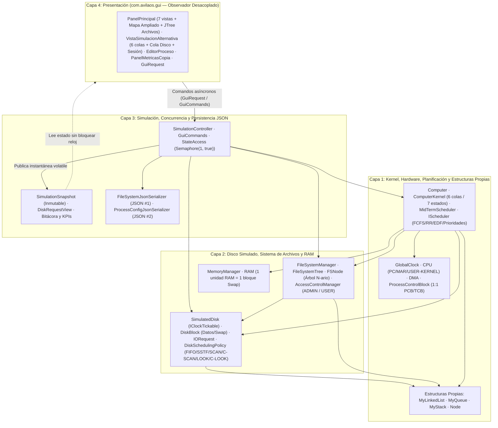
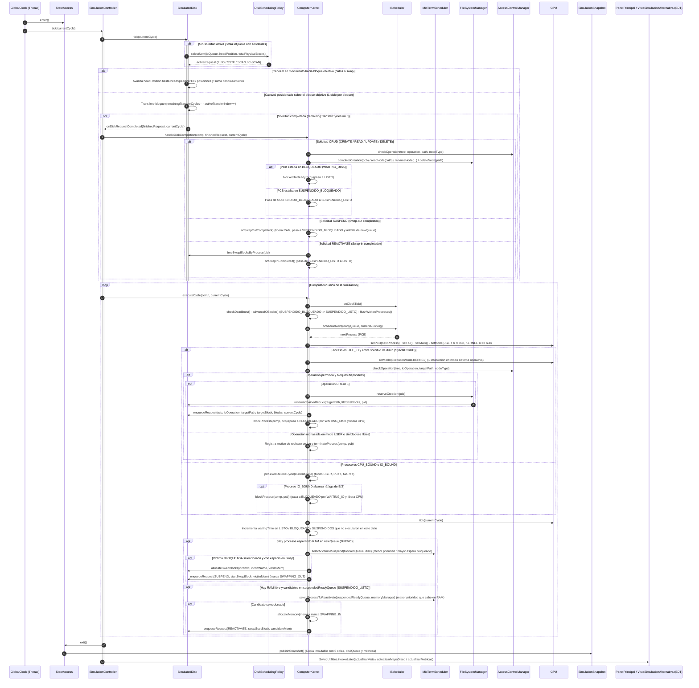

# 🏔️ ÁvilaOS — Simulador de Sistema Operativo, Sistema de Archivos y Planificación de Disco

> **Proyecto 2 — Sistemas Operativos**  
> Simulador en tiempo real de un sistema operativo monohilo dotado de planificación de CPU, **Sistema de Archivos Jerárquico (Árbol N-ario)**, **Disco Simulado con Asignación Encadenada y Área de Swap**, **Cola única de E/S** con políticas de cabezal intercambiables en caliente (`FIFO`, `SSTF`, `SCAN`, `C-SCAN`), **Modelo de 7 Estados con Suspensión/Reactivación (`MidTermScheduler`)**, **Control de Sesión (`ADMIN` / `USER`)** y **carga de dos JSON y guardado del sistema de archivos**.

📄 [Ver informe técnico del equipo](https://docs.google.com/document/d/1tdR2iUPuEp1S2k3T6HdUEbeLmFPWlkAu1J59QRHgm1o/edit?usp=sharing)

---

## 📋 Tabla de Contenidos
1. [Características Principales](#-características-principales)
2. [Requisitos y Ejecución](#-requisitos-y-ejecución)
3. [Arquitectura por Capas](#-arquitectura-por-capas)
4. [Diagrama UML de Clases](#-diagrama-uml-de-clases)
5. [Diagrama UML de Secuencia](#-diagrama-uml-de-secuencia)
6. [Estructura de Paquetes](#-estructura-de-paquetes)
7. [Escenarios JSON Incluidos](#-escenarios-json-incluidos)
8. [Informe Técnico Completo](#-informe-técnico-completo)

---

## ✨ Características Principales

* **Modelo de 7 Estados y Planificación de CPU (`IScheduler` + `MidTermScheduler`):**
  * Estados `NUEVO`, `LISTO`, `EJECUTANDO`, `BLOQUEADO`, `SUSPENDIDO_LISTO`, `SUSPENDIDO_BLOQUEADO` y `TERMINADO`. El proceso en ejecución ocupa la CPU; las demás situaciones se representan en colas.
  * **4 políticas de corto plazo intercambiables en caliente:** `FCFS` (`FcfsScheduler`), `Round Robin` (`RoundRobinScheduler`), `EDF` (`EdfScheduler`) y `Prioridades Apropiativas` (`PreemptivePriorityScheduler`).
  * **Planificador a mediano plazo (`MidTermScheduler`):** Suspende procesos bloqueados hacia el área de intercambio (`Swap-out`, por menor prioridad / mayor espera bloqueado) cuando un proceso nuevo no cabe en `RAM`, transiciona procesos de `SUSPENDIDO_BLOQUEADO` a `SUSPENDIDO_LISTO` al completarse su evento de E/S o disco, y los reactiva (`Swap-in`, mayor prioridad) al liberarse memoria.
* **Disco Simulado y Asignación Encadenada (`com.avilaos.disk`):**
  * Bloques físicos numerados separados en **área de datos** y **área de swap** (equivalencia `1 unidad RAM = 1 bloque Swap`).
  * Asignación encadenada de archivos (`DiskBlock.nextBlock` / `END_OF_CHAIN`) con reserva atómica en dos fases (`reserveChainedBlocks` / `finishReservation`).
  * **Cola única de E/S (`IORequest`):** Todas las solicitudes CRUD (`CREATE`, `READ`, `UPDATE`, `DELETE`) y de intercambio (`SUSPEND`, `REACTIVATE`) compiten en la misma cola del disco y muestran su estado en tiempo real en `03 Disco` y `06 Simulación`.
  * **Políticas de planificación de cabezal en caliente (`DiskSchedulingPolicy`):** `FIFO`, `SSTF`, `SCAN` (con rebote en extremo), `C-SCAN` (retorno circular sin sumar el salto de vuelta). Hay implementaciones de `LOOK` y `C-LOOK`, pero no están en el selector de la interfaz.
  * **Configuración segura:** Cambio de velocidad del cabezal (`1–500` bloques/ciclo) y redimensionamiento con el reloj detenido o pausado. Conserva archivos, métricas y lecturas pendientes si sus destinos siguen siendo válidos; rechaza cambios con swap ocupado, reservas, otras operaciones pendientes o ciertos barridos, o cuando bloques o cabezal quedarían fuera.
* **Sistema de Archivos Jerárquico y Control de Acceso (`com.avilaos.filesystem`):**
  * Árbol N-ario 100% propio (`FileSystemTree` / `FSNode`), sin colecciones de `java.util.*`, con raíz `/` en el bloque `0`.
  * Toda operación CRUD se ejecuta exclusivamente mediante procesos `ProcessType.FILE_IO` que pasan a `ExecutionMode.KERNEL` y bloquean por disco (`BlockReason.WAITING_DISK`).
  * Modos de sesión **`ADMIN`** (control total) y **`USER`** (lectura de archivos propios o `PUBLIC`, creación dentro de directorios propios y eliminación de archivos propios; sin renombrar ni eliminar directorios).
* **Estructuras de Datos 100% Propias (`com.avilaos.core.structures`):** Implementación desde cero de `Node<T>`, `MyLinkedList<T>` (con `sort` in-situ), `MyQueue<T>` y `MyStack<T>`, sin utilizar colecciones de `java.util.*`.
* **Interfaz Gráfica y Observabilidad en Tiempo Real (`com.avilaos.gui`):**
  * **7 módulos laterales:** `01 Inicio`, `02 Computador`, `03 Disco` (con **Mapa vertical ampliable en vivo `Ampliar mapa ⤢`** y cola de E/S), `04 Archivos` (`JTree` + detalles/CRUD + tabla de asignación), `05 Procesos`, `06 Simulación` (6 tablas de colas, cola única de E/S del disco y bitácora) y `07 Métricas` (gráficas `JFreeChart` de CPU, disco y suspensiones/reactivaciones).
* **JSON (`com.avilaos.io`):** Inicio permite cargar los dos JSON y guardar el sistema de archivos. El botón de guardar procesos está deshabilitado. El JSON guardado no es un checkpoint completo de procesos suspendidos o solicitudes activas.

---

## 🚀 Requisitos y Ejecución

* **Java:** JDK 25 (configurado en `pom.xml` con `maven.compiler.source` y `maven.compiler.target` en `25`).
* **IDE:** Apache NetBeans (proyecto Maven; requerido por el enunciado).
* **Librerías autorizadas (vía Maven):** `com.google.code.gson:gson:2.11.0` y `org.jfree:jfreechart:1.5.4`.

### Ejecución desde Terminal (PowerShell)
```powershell
cd Proyecto2.SistemasOperativos
mvn clean compile exec:java "-Dexec.mainClass=com.avilaos.Main"
```

Las pruebas son en su mayoría programas con método `main`; un `mvn test` exitoso no demuestra por sí solo que Surefire las haya ejecutado.

### Ejecución desde Apache NetBeans
1. Abrir el proyecto Maven en NetBeans.
2. Verificar en *Project Properties → Libraries* que `Java Platform` apunte a **JDK 25**.
3. Ejecutar **Clean and Build** y luego **Run Project (F6)**.

---

## 🏛️ Arquitectura por Capas



---

## 📐 Diagrama UML de Clases

```mermaid
classDiagram
    direction TB

    class IClockTickable {
        <<interface>>
        +tick(int currentCycle) void
    }

    class IScheduler {
        <<interface>>
        +scheduleNext(MyQueue~ProcessControlBlock~ queue, ProcessControlBlock currentRunning) ProcessControlBlock
        +addProcess(ProcessControlBlock process) void
        +removeProcess(ProcessControlBlock process) void
        +getReadyQueue() MyQueue~ProcessControlBlock~
        +getType() SchedulingPolicyType
        +onClockTick() void
    }

    class DiskSchedulingPolicy {
        <<interface>>
        +selectNext(MyLinkedList~IORequest~ queue, int currentHeadPosition, int totalBlocks) IORequest
        +getPolicyType() DiskSchedulingPolicyType
        +reset() void
    }

    class DiskRequest

    class ProcessState {
        <<enumeration>>
        NUEVO
        LISTO
        EJECUTANDO
        BLOQUEADO
        TERMINADO
        SUSPENDIDO_LISTO
        SUSPENDIDO_BLOQUEADO
    }

    class ProcessType {
        <<enumeration>>
        CPU_BOUND
        IO_BOUND
        PRODUCER
        CONSUMER
        FILE_IO
    }

    class IOOperationType {
        <<enumeration>>
        CREATE
        READ
        UPDATE
        DELETE
        SUSPEND
        REACTIVATE
    }

    class UserMode {
        <<enumeration>>
        ADMIN
        USER
    }

    class ExecutionMode {
        <<enumeration>>
        USER
        KERNEL
    }

    class SchedulingPolicyType {
        <<enumeration>>
        FCFS
        ROUND_ROBIN
        EDF
        PRIORITY_PREEMPTIVE
    }

    class DiskSchedulingPolicyType {
        <<enumeration>>
        FIFO
        SSTF
        SCAN
        C_SCAN
        LOOK
        C_LOOK
    }

    class HeadDirection {
        <<enumeration>>
        UP
        DOWN
    }

    class BlockReason {
        <<enumeration>>
        NONE
        WAITING_MUTEX
        WAITING_EMPTY_BUFFER
        WAITING_FULL_BUFFER
        NETWORK_LATENCY
        WAITING_IO
        WAITING_DISK
        SWAPPING_OUT
        SWAPPING_IN
    }

    class FilePermission {
        <<enumeration>>
        PUBLIC
        PRIVATE
    }

    class FsNodeType {
        <<enumeration>>
        DIRECTORY
        FILE
    }

    class MyLinkedList~T~ {
        +append(T data) void
        +get(int index) T
        +deletePos(int pos) void
        +remove(T data) boolean
        +sort(MyComparator~T~ comp) void
        +size() int
    }

    class MyQueue~T~ {
        +enqueue(T item) void
        +dequeue() T
        +peek() T
        +removeElement(T data) boolean
        +toArray() Object[]
    }

    class GlobalClock {
        -GlobalClock INSTANCE$
        -MyLinkedList~IClockTickable~ subscribers
        -int cycleCounter
        -int cycleDurationMs
        -boolean running
        -boolean paused
        -Thread clockThread
        +getInstance()$ GlobalClock
        +start() void
        +pause() void
        +resume() void
        +step() void
        +reset() void
        +run() void
    }

    class SimulationController {
        -SimulationController instance$
        -MyLinkedList~Computer~ computers
        -GlobalClock clock
        -SimulatedDisk disk
        -FileSystemManager fileSystemManager
        -AccessControlManager accessControl
        -UserMode currentMode
        -SimulationSnapshot snapshot
        +getInstance()$ SimulationController
        +createComputer(String name, int ramSize, SchedulingPolicyType policy, int quantum) Computer
        +createProcess(...) ProcessControlBlock
        +requestCreation(String path, FsNodeType type, int blocks, String owner, FilePermission perm) ProcessControlBlock
        +requestRead(String path) ProcessControlBlock
        +requestRename(String path, String newName) ProcessControlBlock
        +requestDelete(String path) ProcessControlBlock
        +loadFileSystemJson(String json) void
        +saveFileSystemJson(File file) void
        +loadProcessesConfigJson(String json) void
        +reconfigurarDisco(int totalBlocks, int swapSizeBlocks, boolean preservarArchivos) void
        +setDiskHeadSpeed(int speed) void
        +setUserSession(UserMode mode, String username) void
        +setComputerPolicy(int id, SchedulingPolicyType policy) void
        +tick(int currentCycle) void
        +reset() void
        +snapshot() SimulationSnapshot
    }

    class Computer {
        -int id
        -String name
        -CPU cpu
        -RAM ram
        -DMA dma
        -ComputerKernel kernel
        -MemoryManager memoryManager
        -SchedulingPolicyType politica
        -int quantum
        -int ciclosActivos
        -int ciclosObservados
        -int procesosCompletados
        -int procesosFinalizados
        -int deadlinesCumplidos
        -int totalTiempoRespuesta
        -int totalTiempoEspera
        +setPolitica(SchedulingPolicyType politica) void
        +setQuantum(int quantum) void
        +registrarCicloObservado() void
        +incrementarCicloActivo() void
        +registrarTerminacion(ProcessControlBlock pcb, int cicloActual) void
        +getSuspensionCount() int
        +getReactivationCount() int
    }

    class ComputerKernel {
        -MyLinkedList~ProcessControlBlock~ processList
        -MyQueue~ProcessControlBlock~ newQueue
        -MyQueue~ProcessControlBlock~ readyQueue
        -MyQueue~ProcessControlBlock~ blockedQueue
        -MyQueue~ProcessControlBlock~ suspendedReadyQueue
        -MyQueue~ProcessControlBlock~ suspendedBlockedQueue
        -MyQueue~ProcessControlBlock~ endedQueue
        -IScheduler activeScheduler
        -MidTermScheduler midTermScheduler
        -SimulatedDisk disk
        -FileSystemManager fileSystemManager
        -AccessControlManager accessControl
        +admitProcess(Computer com, ProcessControlBlock p) boolean
        +evaluateNewQueueAdmission(Computer com) int
        +onPolicyChanged(Computer com) void
        +reorderReadyQueue(SchedulingPolicyType policy, boolean restoreFifo) void
        +dispatch(Computer com, ProcessControlBlock p) void
        +executeCycle(Computer comp, int currentCycle) void
        +evaluateMidTermSuspension(Computer com, ProcessControlBlock targetNew) void
        +onSwapOutCompleted(Computer com, IORequest request) void
        +evaluateMidTermReactivation(Computer com) void
        +onSwapInCompleted(Computer com, IORequest request) void
        +handleDiskCompletion(Computer com, IORequest request, int cycle) void
        +blockProcess(Computer com, ProcessControlBlock p) void
        +blockedToReady(ProcessControlBlock p) void
        +terminateProcess(Computer com, ProcessControlBlock p) void
    }

    class MidTermScheduler {
        +selectVictimToSuspend(MyQueue~ProcessControlBlock~ blockedQueue, SimulatedDisk disk) ProcessControlBlock
        +selectProcessToReactivate(MyQueue~ProcessControlBlock~ suspendedReadyQueue, MemoryManager memoryManager) ProcessControlBlock
    }

    class ProcessControlBlock {
        -int id
        -String name
        -int computerId
        -ProcessState state
        -ProcessType type
        -ExecutionMode mode
        -BlockReason blockReason
        -BlockReason preSuspensionBlockReason
        -int priority
        -int requiredMemory
        -int assignedMemory
        -int totalInstructions
        -int remainingTime
        -int deadline
        -int remainingDeadline
        -int arrivalCycle
        -int startCycle
        -int completionCycle
        -int waitingTime
        -int programCounter
        -int memoryAddressRegister
        -IOOperationType ioOperation
        -String targetPath
        -String newFileName
        -int fileSizeBlocks
        -String owner
        -int reservedStart
        -int swapStartBlock
        -int suspensionCount
        -int reactivationCount
        +executeOneCycle(int currentCycle) void
        +updateDeadlineOnTick(int currentCycle) void
        +incrementWaitingTime() void
        +resetIdGenerator(int initialValue)$ void
    }

    class CPU {
        -int PC
        -int MAR
        -int IR
        -ProcessControlBlock PCB
        -ExecutionMode mode
        +tick(int currentCycle) void
        +setPCB(ProcessControlBlock PCB) void
    }

    class MemoryManager {
        -RAM ram
        +hasAvailableMemory(int amount) boolean
        +allocateMemory(int amount) boolean
        +freeMemory(int amount) void
        +getFreeMemory() int
    }

    class SimulatedDisk {
        -int totalBlocks
        -int swapSizeBlocks
        -DiskBlock[] blocks
        -Semaphore blockMapMutex
        -MyLinkedList~IORequest~ ioQueue
        -Semaphore queueMutex
        -DiskSchedulingPolicy schedulingPolicy
        -IORequest activeRequest
        -int headPosition
        -HeadDirection headDirection
        -int headSpeedPerTick
        -int totalHeadMovement
        -int completedRequestsCount
        +tick(int currentCycle) void
        +enqueueRequest(ProcessControlBlock pcb, IOOperationType op, String path, int targetBlock, int blockCount, int arrivalCycle) IORequest
        +allocateChainedBlocks(String filePath, int count, int ownerPid) int
        +reserveChainedBlocks(String filePath, int count, int ownerPid) int
        +finishReservation(int startBlock, int ownerPid, boolean confirm) boolean
        +freeChainedBlocks(int startBlock) int
        +allocateSwapBlocks(int processId, String processName, int memoryUnits) int
        +freeSwapBlocksByProcess(int processId) int
        +setSchedulingPolicy(DiskSchedulingPolicy policy) void
    }

    class DiskBlock {
        -int blockNumber
        -boolean swapBlock
        -boolean occupied
        -boolean reserved
        -String occupiedBy
        -int ownerProcessId
        -int nextBlock
        +allocate(String path, int ownerPid, int nextBlock) void
        +free() void
    }

    class IORequest {
        -int id
        -ProcessControlBlock pcb
        -IOOperationType operation
        -String path
        -int targetBlock
        -int blockCount
        -int arrivalCycle
        -int[] transferBlocks
        ~getTransferBlock(int index) int
    }

    class FileSystemManager {
        -FileSystemTree tree
        -SimulatedDisk disk
        -Semaphore fsMutex
        +createFile(String fullPath, int sizeBlocks, String owner, FilePermission perm, String creator, int pid) FSNode
        +createDirectory(String fullPath, String owner, FilePermission perm, String creator) FSNode
        +reserveCreation(ProcessControlBlock p) int
        +completeCreation(ProcessControlBlock p) void
        +readNode(String fullPath) FSNode
        +renameNode(String fullPath, String newName) FSNode
        +deleteNode(String fullPath) int
        +snapshotTree() FSNode
    }

    class FileSystemTree {
        -FSNode root
        +find(String path) FSNode
        +insertAtPath(String fullPath, FsNodeType type, String owner, FilePermission perm, int firstBlock, int sizeBlocks) FSNode
        +rename(String path, String newName) void
        +remove(String path) MyLinkedList~FSNode~
    }

    class FSNode {
        -String name
        -FsNodeType type
        -String owner
        -FilePermission permission
        -int firstBlock
        -int sizeBlocks
        -String creatorProcess
        -String colorHex
        -FSNode parent
        -MyLinkedList~FSNode~ children
        +getPath() String
        +findChild(String name) FSNode
    }

    class AccessControlManager {
        -UserMode activeMode
        -String activeUsername
        -Semaphore accessMutex
        +setSession(UserMode mode, String username) void
        +checkOperation(FileSystemTree tree, IOOperationType op, String targetPath, FsNodeType targetType) AccessDecision
        +canChangePolicy() AccessDecision
    }

    class FcfsScheduler
    class RoundRobinScheduler {
        -int quantum
        -int currentQuantumRemaining
        +setQuantum(int quantum) void
    }
    class EdfScheduler {
        +sortReadyQueue(MyQueue~ProcessControlBlock~ queue) void
    }
    class PreemptivePriorityScheduler {
        +sortReadyQueue(MyQueue~ProcessControlBlock~ queue) void
    }

    class FIFODiskPolicy
    class SSTFDiskPolicy
    class SCANDiskPolicy
    class CSCANDiskPolicy
    class LOOKDiskPolicy
    class CLOOKDiskPolicy

    IClockTickable <|.. SimulationController
    IClockTickable <|.. SimulatedDisk
    IClockTickable <|.. CPU
    IScheduler <|.. FcfsScheduler
    IScheduler <|.. RoundRobinScheduler
    IScheduler <|.. EdfScheduler
    IScheduler <|.. PreemptivePriorityScheduler
    DiskSchedulingPolicy <|.. FIFODiskPolicy
    DiskSchedulingPolicy <|.. SSTFDiskPolicy
    DiskSchedulingPolicy <|.. SCANDiskPolicy
    DiskSchedulingPolicy <|.. CSCANDiskPolicy
    DiskSchedulingPolicy <|.. LOOKDiskPolicy
    DiskSchedulingPolicy <|.. CLOOKDiskPolicy
    IORequest <|-- DiskRequest

    SimulationController --> GlobalClock : se suscribe
    SimulationController "1" *-- "1" Computer : gestiona
    SimulationController "1" *-- "1" SimulatedDisk : gestiona
    SimulationController "1" *-- "1" FileSystemManager : gestiona
    SimulationController "1" *-- "1" AccessControlManager : gestiona
    Computer "1" *-- "1" CPU
    Computer "1" *-- "1" MemoryManager
    Computer "1" *-- "1" ComputerKernel
    ComputerKernel --> IScheduler : delega selección CPU
    ComputerKernel "1" *-- "1" MidTermScheduler : delega suspensión/swap
    ComputerKernel "1" *-- "0..*" ProcessControlBlock : administra 6 colas
    ComputerKernel --> SimulatedDisk : encola E/S y swap
    ComputerKernel --> FileSystemManager : ejecuta CRUD
    ComputerKernel --> AccessControlManager : valida permisos
    SimulatedDisk --> DiskSchedulingPolicy : delega selección E/S
    SimulatedDisk "1" *-- "1..*" DiskBlock : contiene datos y swap
    SimulatedDisk "1" *-- "0..*" IORequest : administra cola única
    SimulatedDisk --> HeadDirection
    SimulatedDisk --> DiskSchedulingPolicyType
    FileSystemManager "1" *-- "1" FileSystemTree : administra jerarquía
    FileSystemManager --> SimulatedDisk : asigna/libera cadenas
    FileSystemTree "1" *-- "1..*" FSNode : árbol N-ario
    FSNode --> FsNodeType
    FSNode --> FilePermission
    AccessControlManager --> UserMode
    ProcessControlBlock --> ProcessState
    ProcessControlBlock --> ProcessType
    ProcessControlBlock --> IOOperationType
    ProcessControlBlock --> ExecutionMode
    ProcessControlBlock --> BlockReason
    CPU --> ExecutionMode
    Computer --> SchedulingPolicyType
```



---

## 🔄 Diagrama UML de Secuencia



---

## 📦 Estructura de Paquetes

```text
src/main/java/com/avilaos/
├── Main.java                                  # Punto de entrada (lanza Swing en el EDT)
├── concurrency/
│   ├── GuiCommands.java                       # Hilo trabajador asíncrono para comandos de la GUI
│   └── StateAccess.java                       # Semáforo binario justo reentrante del modelo
├── core/
│   ├── kernel/
│   │   ├── ComputerKernel.java                # Núcleo del SO: 6 colas (7 estados), syscalls FILE_IO y Swap
│   │   ├── GlobalClock.java                   # Reloj global Singleton multihilo
│   │   └── IClockTickable.java                # Interfaz para componentes sincronizados por reloj
│   ├── model/
│   │   ├── BlockReason.java                   # Enum de motivos de bloqueo (WAITING_DISK, SWAPPING_OUT/IN, etc.)
│   │   ├── ExecutionMode.java                 # Enum de privilegio de CPU (USER / KERNEL)
│   │   ├── IOOperationType.java               # Enum CRUD + SUSPEND / REACTIVATE
│   │   ├── ProcessControlBlock.java           # PCB unificado 1:1 (contexto, E/S y contadores de Swap)
│   │   ├── ProcessSizing.java                 # Cálculo de memoria RAM derivada para procesos manuales
│   │   ├── ProcessState.java                  # Enum de los 7 estados del proceso
│   │   ├── ProcessType.java                   # Enum de tipos (CPU_BOUND, IO_BOUND, FILE_IO, etc.)
│   │   ├── SchedulingPolicyType.java          # Enum de políticas de CPU
│   │   └── UserMode.java                      # Enum de sesión (ADMIN / USER)
│   ├── scheduler/
│   │   ├── IScheduler.java                    # Interfaz de planificación a corto plazo
│   │   ├── FcfsScheduler.java                 # Política First-Come, First-Served
│   │   ├── RoundRobinScheduler.java           # Política Round Robin con quantum dinámico
│   │   ├── EdfScheduler.java                  # Política Earliest Deadline First apropiativa
│   │   ├── PreemptivePriorityScheduler.java   # Política de Prioridades Apropiativas
│   │   └── MidTermScheduler.java              # Planificador a mediano plazo (Swap-out y Swap-in)
│   └── structures/
│       ├── Node.java                          # Nodo genérico enlazado
│       ├── MyLinkedList.java                  # Lista simplemente enlazada genérica propia con sort in-situ
│       ├── MyQueue.java                       # Cola FIFO genérica propia
│       ├── MyStack.java                       # Pila LIFO genérica propia
│       └── EstructuraVaciaException.java      # Excepción propia de estructura vacía
├── disk/
│   ├── SimulatedDisk.java                     # Disco simulado: bloques, swap, cola única y movimiento del cabezal
│   ├── DiskBlock.java                         # Bloque físico (datos o swap) con puntero nextBlock
│   ├── IORequest.java                         # Solicitud de E/S en cola con cadena transferBlocks
│   ├── DiskRequest.java                       # Clase de compatibilidad que extiende IORequest
│   ├── DiskSchedulingPolicy.java              # Interfaz Strategy para políticas del cabezal
│   ├── DiskSchedulingPolicyType.java          # Enum (FIFO, SSTF, SCAN, C_SCAN, LOOK, C_LOOK)
│   ├── DiskSchedulerFactory.java              # Fábrica para instanciar políticas en caliente
│   ├── HeadDirection.java                     # Dirección actual del cabezal (UP / DOWN)
│   └── policies/
│       ├── FIFODiskPolicy.java                # Atención en orden de llegada
│       ├── SSTFDiskPolicy.java                # Menor distancia al cabezal
│       ├── SCANDiskPolicy.java                # Barrido bidireccional con rebote en extremos
│       ├── CSCANDiskPolicy.java               # Barrido circular ascendente (salto sin costo)
│       ├── LOOKDiskPolicy.java                # Variante LOOK
│       └── CLOOKDiskPolicy.java               # Variante C-LOOK
├── filesystem/
│   ├── FileSystemManager.java                 # Operaciones CRUD sobre árbol y cadenas en disco
│   ├── FileSystemTree.java                    # Árbol N-ario propio con raíz "/"
│   ├── FSNode.java                            # Nodo de directorio/archivo con metadatos y color
│   ├── FsNodeType.java                        # Enum DIRECTORY / FILE
│   ├── FilePermission.java                    # Enum PUBLIC / PRIVATE
│   └── AccessControlManager.java              # Validación de permisos según sesión ADMIN / USER
├── hardware/
│   ├── Computer.java                          # Computador único y acumulador de métricas
│   ├── CPU.java                               # Procesador simulado (PC, MAR, IR, ExecutionMode)
│   ├── RAM.java                               # Memoria física simulada
│   └── DMA.java                               # Controlador de acceso directo a memoria
├── memory/
│   └── MemoryManager.java                     # Gestor contable sincronizado de RAM
├── io/
│   ├── FileSystemJsonSerializer.java          # Lector/escritor validado del JSON #1 (Sistema de Archivos)
│   └── ProcessConfigJsonSerializer.java       # Lector/escritor validado del JSON #2 (Procesos y Config)
├── simulation/
│   ├── SimulationController.java              # Orquestador central, JSON dual y reconfiguración segura
│   └── SimulationSnapshot.java                # Instantánea inmutable (6 colas, diskQueue y métricas)
└── gui/
    ├── PanelPrincipal.java                    # Ventana principal (01 Inicio .. 04 Archivos + Mapa Ampliado)
    ├── VistaSimulacionAlternativa.java        # 06 Simulación: reloj, sesión, 6 colas, cola de disco y log
    ├── EditorProceso.java                     # 05 Procesos: creación manual validada
    ├── PanelMetricasCopia.java                # 07 Métricas: indicadores y gráficas de CPU, disco y swap
    ├── ConfiguracionSimulacion.java           # Puentes de carga/guardado para las vistas
    ├── GuiRequest.java                        # Puente seguro EDT -> Worker
    ├── RelojAnimado.java                      # Indicador visual del reloj global
    └── LogoAvila.java                         # Identidad gráfica vectorial
```

---

## 🧪 Escenarios JSON Incluidos

En `escenarios/carga-json/` se incluyen escenarios listos para probar la carga dual, organizados en subcarpetas para una selección limpia e intuitiva:

* **📁 `sistema-archivos/` (Tarjeta Sistema de archivos):**
  * `01-sistema-enunciado.json` (caso base con cabezal en 50 y 8 archivos en bloques 11 a 180).
  * `02-disco-vacio.json`, `10-disco-ocupacion-agrupada.json`, `11-disco-lleno.json`, `12-disco-disperso.json`, `13-arbol-complejo.json`, `14-disco-grande-800.json`.
  * Casos de validación negativa: `03-cabezal-invalido.json`, `04-sin-sistema-archivos.json`.
* **📁 `procesos/` (Tarjeta Procesos y configuración):**
  * `05-procesos-enunciado.json` (8 procesos correspondientes al escenario 01).
  * `09-cambio-fcfs-prioridades.json` (planificación de CPU con desalojo).
  * `15-sstf-caso-p2.json` (ocho lecturas con SSTF; el orden depende de la llegada de las solicitudes y se verifica en el log).
  * Lista vacía: `06-procesos-vacios.json`. Casos inválidos: `07-sin-computador.json`, `08-json-malformado.json`.

---

## 📄 Informe Técnico Completo

El documento detallado con el desglose completo de clases, métodos, enums, interfaces, conclusiones comparativas de políticas de disco (`FIFO`, `SSTF`, `SCAN`, `C-SCAN`) y análisis cuantitativo del efecto de la suspensión (`Swap`) se encuentra en:  
👉 [Abrir informe técnico del equipo](https://docs.google.com/document/d/1tdR2iUPuEp1S2k3T6HdUEbeLmFPWlkAu1J59QRHgm1o/edit?usp=sharing)


### Convenciones para los ejemplos oficiales

El JSON `diskConfig.totalBlocks` representa bloques de datos; el swap se añade para obtener el total físico. El control de Disco muestra esa suma. El ejemplo oficial incluye operaciones `UPDATE` sin `newFileName`: en ese caso se genera un nombre disponible como `notas_actualizado.txt`, añadiendo un número ante colisiones. El log registra el nombre; si se indica `newFileName`, se usa el nombre suministrado.

En C-SCAN el salto de retorno a cero se considera instantáneo y no se suma al desplazamiento. Los contadores de suspensión y reactivación aumentan al iniciar cada transferencia.
