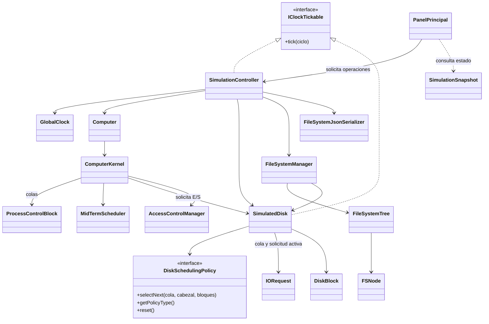

# ÁvilaOS — borrador técnico y diagramas para la entrega

Base: rama `revision/validacion-develop`. Este documento es un borrador preparado en modo entrega con ayuda de IA; sus diagramas y conclusiones deben revisarse con el código y el equipo antes de incorporarlos al informe final. Los resultados representan las pruebas identificadas, no una certificación de todos los casos.

## 1. Objetivo y alcance

ÁvilaOS simula un computador con planificación de CPU, memoria principal, un disco local con archivos jerárquicos, planificación de E/S y suspensión de procesos mediante swap. La interfaz observa el estado de la simulación y envía solicitudes al controlador. El reloj hace avanzar la simulación por ciclos. El Proyecto 2 emplea un solo computador.

El sistema distingue los modos ADMIN y USER y registra eventos de planificación, operaciones de disco y suspensión. La carga y el guardado del sistema de archivos utilizan JSON; el JSON guardado no es un checkpoint completo de procesos suspendidos ni de solicitudes activas.

## 2. Componentes y responsabilidades

| Componente | Responsabilidad y operaciones principales |
|---|---|
| `PanelPrincipal`, `EditorProceso`, `VistaSimulacionAlternativa`, `PanelMetricasCopia` | Presentan los controles y observan la simulación. Envían trabajo mediante `GuiRequest`; las vistas usan `SimulationSnapshot` para leer el estado. |
| `SimulationController` | Coordina computador, reloj, disco y sistema de archivos. Crea procesos y solicitudes, administra sesión, carga o guarda JSON y publica snapshots. `setDiskHeadSpeed` valida permisos y rango. |
| `GlobalClock` / `IClockTickable` | El reloj avanza los ciclos; los componentes suscritos reciben `tick`. El estado compartido se protege con `StateAccess`, construido sobre un semáforo reentrante. |
| `Computer` / `ComputerKernel` / `CPU` / `MemoryManager` | Agrupan el procesador, la memoria y las colas; el kernel planifica procesos, genera solicitudes de disco y administra las transiciones asociadas al swap. |
| `ProcessControlBlock` | Conserva identidad, estado, prioridad, memoria, operación y ruta de E/S, además de contadores y contexto del proceso. |
| `MidTermScheduler` | Elige una víctima bloqueada de menor prioridad viable para suspensión; desempata por espera. Para reactivar, elige un listo/suspendido que quepa en RAM, favoreciendo mayor prioridad y después mayor espera. |
| `SimulatedDisk` / `DiskBlock` / `IORequest` | Mantienen bloques, asignación encadenada, área de swap y cola de E/S. El disco atiende una solicitud a la vez y avanza el cabezal en sus ciclos. |
| `DiskSchedulingPolicy` y sus implementaciones | La interfaz define la selección de la siguiente solicitud. Se implementan FIFO, SSTF, SCAN, C-SCAN y las adicionales LOOK y C-LOOK. |
| `FileSystemManager` / `FileSystemTree` / `FSNode` | Mantienen la jerarquía y coordinan asignación o liberación de bloques. Cada nodo conserva ruta, tipo, dueño y permisos. |
| `AccessControlManager` | Comprueba permisos según modo e identidad. La solicitud conserva la identidad del solicitante. |
| `FileSystemJsonSerializer` / `ProcessConfigJsonSerializer` | Validan y leen el JSON de archivos y el de procesos, respectivamente. El primero también serializa y guarda el sistema de archivos. |
| `SimulationSnapshot` | Copia datos del modelo para las vistas; incluye muestras históricas de CPU y disco. |

Los enums principales son `ProcessState`, `ProcessType`, `BlockReason`, `IOOperationType`, `DiskSchedulingPolicyType`, `SchedulingPolicyType`, `UserMode`, `ExecutionMode`, `FilePermission`, `FsNodeType` y `HeadDirection`. Sus valores definen alternativas del modelo; las interfaces `IClockTickable` y `DiskSchedulingPolicy` fijan contratos de reloj y de planificación de disco.

## 3. Diagrama UML 1: clases y relaciones principales



Es una vista simplificada: no incluye todos los atributos, métodos ni relaciones auxiliares. La asociación de estrategias con sus clases concretas se omite para facilitar la lectura.

## 4. Diagrama UML 2: solicitud de lectura de archivo

```mermaid
sequenceDiagram
    actor Usuario
    participant Vista as Interfaz
    participant Control as SimulationController
    participant Kernel as ComputerKernel
    participant Disco as SimulatedDisk
    participant Archivos as FileSystemManager
    Usuario->>Vista: Solicita lectura de una ruta
    Vista->>Control: Crear proceso de E/S
    Control->>Kernel: Admitir PCB
    Note over Kernel: El proceso espera CPU según la política
    Kernel->>Disco: Encolar solicitud READ
    Note over Kernel: PCB pasa a bloqueado por E/S; CPU queda disponible
    loop Ciclos de reloj
        Disco->>Disco: Seleccionar solicitud, mover cabezal y transferir bloques
    end
    Disco-->>Control: Notificar finalización
    Control->>Kernel: Comunicar finalización
    Kernel->>Archivos: Resolver lectura y validar resultado
    Kernel->>Kernel: Desbloquear proceso o registrar fallo
    Note over Kernel: Cuando vuelve a CPU, el proceso concluye
```

La representación simplifica llamadas internas. El recorrido real debe contrastarse con `ComputerKernel.handleDiskCompletion` y las pruebas de E/S antes de usarlo como diagrama definitivo.

## 5. Suspensión y reactivación

Cuando un proceso nuevo necesita RAM y no puede ser admitido, el kernel consulta al planificador a mediano plazo. La víctima debe estar bloqueada y debe haber espacio suficiente en swap. El kernel reserva bloques, genera una solicitud de suspensión y, al completarse la transferencia, libera la RAM y ubica el PCB en la cola suspendida correspondiente. Si su evento ocurre mientras está suspendido, puede pasar de bloqueado/suspendido a listo/suspendido. Cuando hay RAM y un candidato apropiado, se solicita la reactivación por el disco; tras el swap-in, se liberan sus bloques y vuelve a listo.

La suspensión puede permitir que otro proceso sea admitido, pero introduce espera por disco y movimiento de cabezal. `EfectoSuspensionTest` compara dos ejecuciones con RAM de dos unidades, una creación de archivo de cinco bloques y un proceso CPU de dos instrucciones; la única diferencia de configuración es el tamaño de swap. Sin swap, el creador terminó en el ciclo 15 y el nuevo en el 17, con 53 bloques de movimiento. Con 100 bloques de swap hubo una suspensión y una reactivación; el nuevo terminó en el ciclo 38 y el creador en el 41, con 251 bloques de movimiento. Ambos finalizaron y conservaron el archivo.

En esta carga concreta, la E/S adicional de swap aumentó el movimiento y la finalización de ambos procesos fue posterior. Esto no demuestra que suspender siempre empeore el rendimiento: el resultado depende de la carga, la ubicación del cabezal y la duración de las operaciones. `DiskAndSwapLogTest` y `CreationSwapIntegrationTest` verifican recorridos de suspensión/reactivación, no todas las cargas posibles.

## 6. Experimento de políticas de disco

`ComparacionPoliticasTest` usa el mismo escenario para cada política: 200 bloques de datos, cabezal inicial 50, velocidad de 30 bloques por ciclo y siete solicitudes simultáneas de un bloque a las posiciones 82, 17, 43, 140, 24, 16 y 190. Todas se completaron.

| Política | Desplazamiento contabilizado (bloques) | Espera media en cola (ciclos) |
|---|---:|---:|
| FIFO | 518 | 11,429 |
| SSTF | 208 | 7,714 |
| SCAN | 332 | 11,286 |
| C-SCAN | 192 | 9,143 |

En esta carga SSTF obtuvo la menor espera media y C-SCAN el menor desplazamiento **según la convención del simulador**. El salto de retorno de C-SCAN no se contabiliza como desplazamiento ni como tiempo de movimiento; por eso su cifra no debe compararse directamente con una medición física que sí cuente ese retorno. Estos resultados dependen de la cola y la posición inicial; no prueban que una política sea siempre superior.

## 7. Estado de pruebas y trabajo pendiente

La última revisión compiló con destino Java 21 y ejecutó con Java 26, en modo sin pantalla. Pasaron 52 programas de prueba y ocho casos adicionales de coordinación. La revisión visual en NetBeans, el runtime Java 21, el redimensionamiento seguro del disco, el escenario heredado `EventosLogTest` y el contraste final del informe siguen pendientes. La rama aún no está fusionada en `develop`.

El estudiante y el equipo deben practicar la defensa: seguir una operación de E/S por las colas, explicar el criterio de víctima, distinguir una solicitud de swap de una operación de archivo, interpretar las métricas y explicar qué datos se guardan y cuáles no. En particular, la IA diseñó e implementó los cambios de guardado, validaciones, velocidad y varias pruebas de esta rama; validación automática no implica que el equipo los domine.
